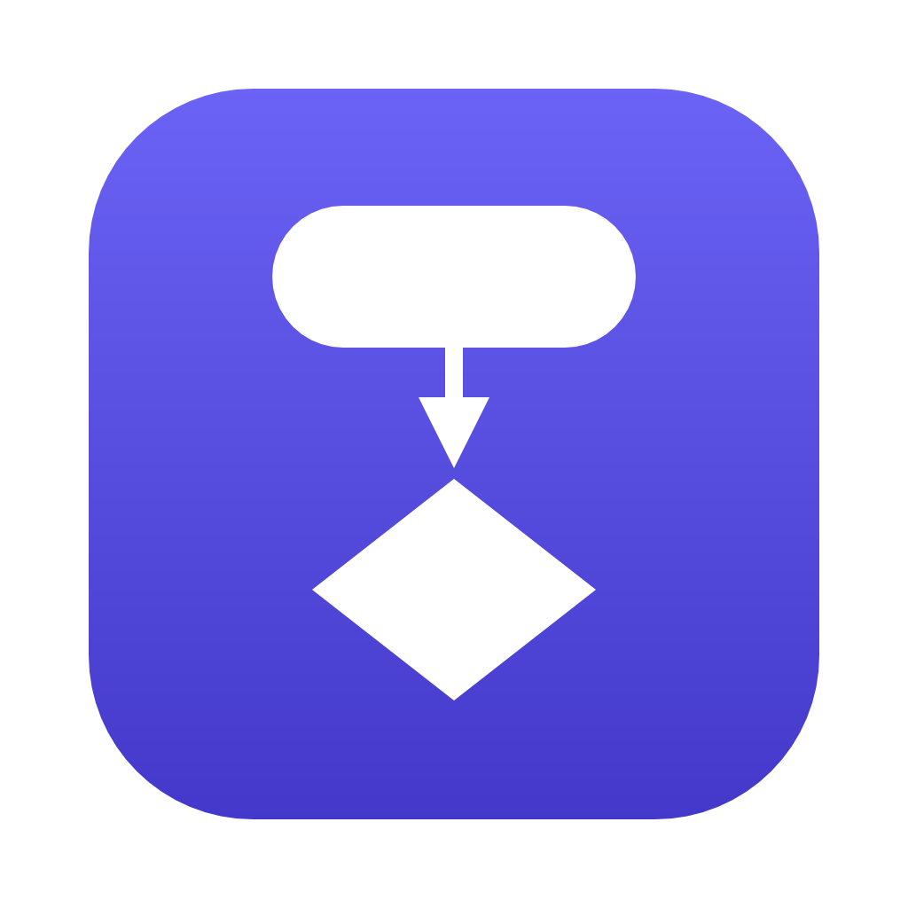
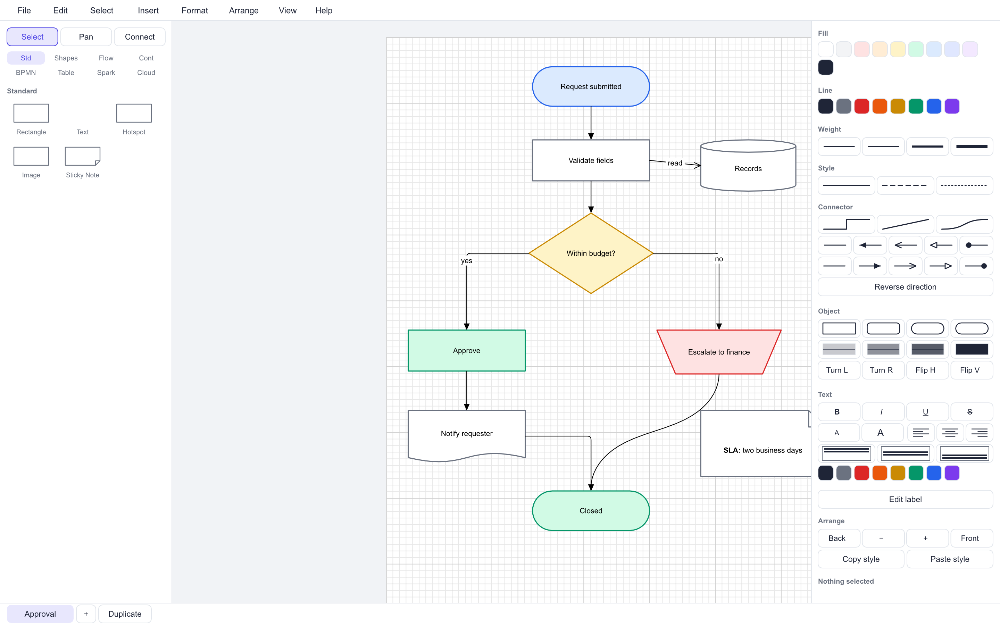
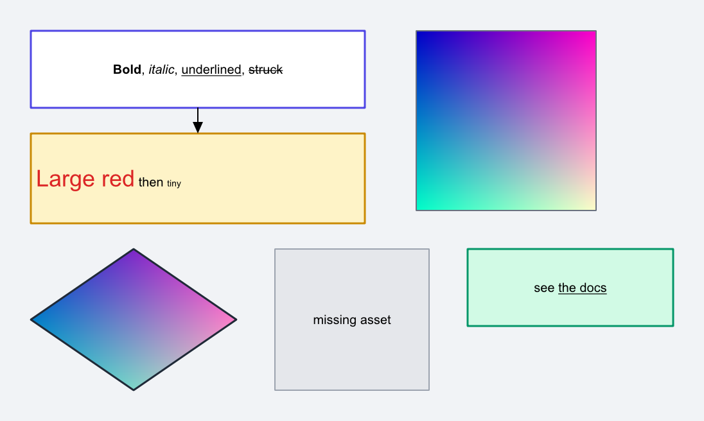
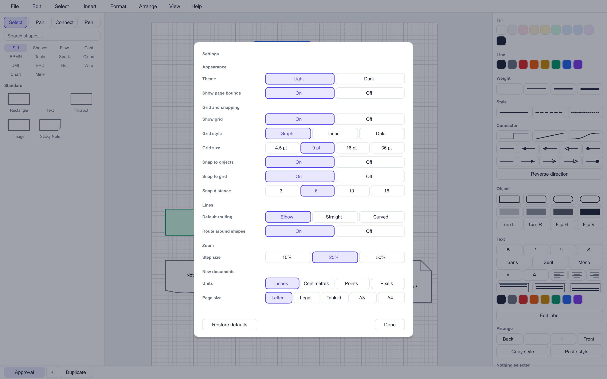

# DiagramCraft



**Open-source diagramming, rebuilt in pure Rust.**

A desktop diagramming editor that reads and writes the Lucid Standard Import
format. Flowcharts, org charts, network diagrams, and the rest — on macOS,
Windows, and Linux, with no subscription and no account.



## Why

Diagramming is one of the last productivity categories without a credible
open-source desktop option. The web tools are good but rented; the desktop tools
are expensive or abandoned. The moat was never the drawing code — it was the
file format, and that format is published.

DiagramCraft is GPU-accelerated vector rendering in pure Rust: an 8.5 MB binary
that opens instantly and does not ship a browser engine to draw rectangles.

## Status

**Early alpha.** The core editing loop is complete and the format round-trips
faithfully. See [Scope](#scope) for what is and is not implemented.

## Features

**Editing**
- Direct manipulation: select, move, resize, rotate, marquee-select
- Alignment snapping with live guides, falling back to the grid
- Align, distribute, match size, group and ungroup
- Rotate, flip, reorder one step or all the way, and change a shape's type
- Copy a style off one object and paint it onto others
- Full undo and redo, with each drag recorded as a single step
- Cut, copy, and paste, including between two running copies
- Multi-page documents: add, duplicate, rename, delete, and drag to reorder
- Containers that carry their contents: drop a shape into a pool or swimlane
  and it travels with the container, which grows to take in what overhangs,
  scales what is inside when resized, and can be fitted back around them
- Tidy Up: a layered arrangement that follows the connectors, so a flowchart
  or an org chart orders itself instead of being dragged into shape
- Lock a shape in place — it still selects, so it can be unlocked, but it
  refuses to move, resize, or be deleted
- Rulers, and guides dragged off them that shapes snap to
- Presentation mode: pages full-screen with the chrome gone, arrow keys or
  a clicker to step through

**Text**
- Edit labels in place: double-click a shape or connector, or press Enter
- Caret, selection, word movement, and multi-line labels
- Per-selection styling: bold, italic, underline, strikethrough, size, and
  colour apply to the characters you highlighted, not the whole label
- Correct handling of graphemes, emoji, and bidirectional text

**Shapes**
- All 68 published shape types across eight libraries: Standard, Shapes,
  Flowchart, Containers, BPMN 2.0, Table, Lucidspark, and the AWS, Azure and
  GCP cloud libraries
- Five more the format does not publish, drawn from their own notations:
  UML (class, interface, package, actor, use case, lifeline, activation,
  component, node, state, fork), entity-relationship (entity, weak entity,
  relationship, attribute and its variants), network (server, router,
  switch, firewall, workstation, laptop, mobile, printer, rack, access
  point), wireframe (browser, phone, button, field, checkbox, radio,
  dropdown, image, nav bar, slider, toggle), and charts (Venn, 2×2 matrix,
  sitemap page, timeline, milestone)
- Star any shape into My Shapes, and save a page as a reusable template —
  both kept beside the settings, so they outlive the document
- Fill, stroke, weight, dash style, corner rounding, opacity, z-order
- Image fills and image blocks, clipped to the shape outline

**Connectors**
- Straight, elbow, and curved routing
- Smart attachment that picks the facing edge as shapes move
- Fixed connection points: aim at a port to pin an end to one edge instead,
  and it keeps that port as either shape moves or turns
- Quick-connect: hover a shape and drag an arrow off its edge to draw a
  connector — let go on empty canvas and the next shape is made, already
  joined, so a flowchart is a run of drags rather than a trip to the palette
- Orthogonal auto-routing that steers around other shapes
- 22 endpoint styles: arrows, UML, BPMN, and ERD crow's-foot notation,
  set per end, with a command to reverse a connector
- Labeled edges



**Files**
- `.lucid` read and write, lossless for fields this build does not interpret
- `.vsdx` import and export: Visio pages, shapes, text, styling, and
  connectors, with every outline written as real Visio geometry
- Bundled images decoded and drawn, clipped to any shape outline
- CSV data linking: match shape labels against a column of a bundled data
  source and the row's columns land in the shape's data panel. Link a file
  on disk and Refresh Data goes back for whatever it says now
- Conditional formatting: colour every shape by one of its data fields, with
  the rules it derived kept on the document so the colours can be retraced
- PNG export, headless and scriptable
- SVG and PDF export, as real vectors with real text: labels stay selectable
  and searchable, and a PDF embeds no font because the families the editor
  offers are the ones every reader already has
- Light and dark themes
- Graph, line, and dot grids

## Install

Requires Rust 1.85 or newer.

```sh
git clone https://github.com/diagramcraft/diagramcraft
cd diagramcraft
cargo run --release
```

On macOS the bare binary works and sets its own dock icon. For a
double-clickable `DiagramCraft.app` with the icon in Finder:

```sh
cargo build --release
scripts/bundle-macos.sh
```

The bundle is unsigned, so another machine will refuse to open it until it is
signed and notarised.

## Usage

```sh
diagramcraft                                  # open the editor
diagramcraft diagram.lucid                    # open a document
diagramcraft drawing.vsdx                     # import a Visio drawing
diagramcraft export in.lucid out.png 2        # render to PNG at 2x
diagramcraft export in.lucid out.svg          # ...or to vector SVG
diagramcraft export in.lucid out.pdf          # ...or to PDF
diagramcraft export in.lucid out.vsdx         # ...or to a Visio drawing
diagramcraft import in.vsdx out.lucid         # convert Visio, headlessly
diagramcraft preview in.lucid shot.png        # screenshot the editor itself
diagramcraft preview in.lucid shot.png --hover   # ...with the connect arrows out
diagramcraft demo out.lucid                   # write the bundled sample
```

Try the sample:

```sh
cargo run --release -- samples/approval.lucid
```

### Interface

Commands live in the menu bar — **File, Edit, Select, Insert, Format, Arrange,
View, Help** — so the whole command surface is in one place with its shortcuts
beside it. On macOS that is the real system menu bar; elsewhere the window
draws its own. The panels hold what you reach for continuously while drawing:
the shape palette on the left, with a tab per library; the properties of the
selection on the right; and the page tabs along the bottom, which can be
dragged to reorder.

The properties panel draws its choices rather than naming them, the way
Lucidchart's does: the weight picker shows the weights, the line-style picker
shows the dashes, the endpoint pickers show the terminators, and the bold
button is bold. Every row marks the value the selection already has, and shows
none when the selection disagrees. The panel is also dynamic — connector rows
appear for connectors, shape rows for shapes, and everything when nothing is
selected.

### Settings

`⌘,` opens the preferences: theme, grid style and size, what snaps to what,
default connector routing, zoom step, and what a new document starts as. They
are saved as you change them and read back at launch.



### Keyboard

| | |
|---|---|
| `V` `H` `C` | select, pan, connector |
| `R` `P` `D` `T` | rectangle, process, decision, text |
| Space (hold) | pan with any tool |
| `⌘Z` / `⇧⌘Z` | undo / redo |
| `⌘S` `⌘O` `⌘N` | save, open, new |
| `⇧⌘S` `⇧⌘E` | save as, export PNG |
| `⌘A` `⌘D` | select all, duplicate |
| `⌘C` `⌘X` `⌘V` | copy, cut, paste |
| `⌘G` / `⇧⌘G` | group / ungroup |
| `⌘]` / `⌘[` | bring forward / send backward |
| `Alt⌘C` / `Alt⌘V` | copy style / paste style |
| `⌘B` `⌘I` `⌘U` `⇧⌘X` | bold, italic, underline, strikethrough |
| `⇧⌘.` / `⇧⌘,` | larger / smaller text |
| `⇧⌘]` / `⇧⌘[` | bring to front / send to back |
| `⌘0` `⌘1` | actual size, zoom to fit |
| `⌘,` | settings |
| Arrows | nudge (hold shift for 10×) |
| Shift-drag | lock axis, or keep proportions on a corner |
| `⌘`-drag | bypass snapping |
| Drag a page tab | reorder pages |

**While editing a label**

| | |
|---|---|
| Double-click, or Enter | open the label under the pointer or selection |
| Enter / Shift-Enter | finish / insert a line break |
| Escape | discard the edit |
| Double-click a word | select it |
| `⌥`-arrows | move by word |
| `⌘`-Home / End | jump to the start or end |
| Double-click a page tab | rename the page |

## The icon

The icon is drawn, not stored: `crates/dc-app/src/icon.rs` composes it from the
same geometry that draws a terminator and a decision on the canvas, so the mark
cannot drift from what the program renders. Regenerate every size with:

```sh
scripts/make-icons.sh          # PNG set and, on macOS, the .icns
diagramcraft icon out.png 512  # or one size, anywhere
```

## Architecture

Seven crates, each independently testable:

| Crate | Responsibility |
|---|---|
| `dc-model` | Document types, serde, markup parsing. No I/O. |
| `dc-lucid` | `.lucid` package read/write and validation. |
| `dc-vsdx` | Visio `.vsdx` import and export: OPC container, XML, units. |
| `dc-geom` | Shape outlines, connector routing, endpoint markers. Pure geometry. |
| `dc-render` | Vello scene construction, camera, theme, text. No GPU ownership. |
| `dc-export` | SVG and PDF writers over one shared traversal. No GPU. |
| `dc-app` | Window, event loop, editor state, undo, menus, settings, chrome. |

The renderer builds scenes without owning a GPU device, so the entire render
path is unit-tested on machines with no graphics hardware. `dc-app`'s editor
logic is likewise separated from the window layer: every tool, gesture,
command, and menu is tested without opening a window.

```sh
cargo test --workspace     # 1091 tests
```

## Scope

Implemented: all eight published shape libraries, all three connector routings,
the published endpoint styles, pages, groups, layers, container membership,
per-selection text styling, the text markup subset, the full `.lucid`
container including its CSV data sources, and `.vsdx` import.

Known limits:

- **Container membership is geometric.** The format marks a container with
  `magnetize` but publishes no field binding a child to one, so membership is
  decided by where a shape sits: a shape counts as inside when its centre is
  within the container. Nothing about the relationship is written to the file,
  which is why it survives a round trip — there is nothing to survive.
- **Conditional formatting is applied, not live.** Running it writes the
  colours onto the shapes, so the canvas, SVG, and PDF all show the same
  thing without any of them needing to know rules exist. Changing the data
  afterwards does not recolour anything until the rules are run again.
- **Five shape libraries are extensions.** UML, ERD, network, wireframe and
  chart shapes have no counterpart in the Standard Import format, so their
  type strings are prefixed `dc`. A document using them round-trips here
  perfectly — the format already carries types a reader does not recognise —
  but another tool will show them as unknown shapes rather than drawing
  them. The eight published libraries are unaffected.
- **Three fields are extensions.** A shape's lock, a page's guides, and the
  document's formatting rules have no published counterpart, so they are
  written under names of our own (`locked`, `dcGuides`, `dcFormatRules`).
  The format already carries fields a reader does not interpret, so these
  cost a round trip nothing — but another tool will not act on them.
- **Data links are a one-time copy.** Matching a shape label against a column
  writes that row into `customData`, which the format does publish. There is
  no live binding back to the CSV, because the format defines none; re-running
  the link after the data changes refreshes the values in place.
- **Text is not shrunk to fit.** A word too long for its shape is broken so
  it wraps rather than running out past the edges, but a label with more
  lines than the shape is tall still overflows — clipped to the shape, and
  pinned to the top so it reads from the beginning. Making it fit is the
  author's decision; there is no autofit that quietly changes a font size.
- **Cloud icon artwork.** AWS, Azure, and GCP shapes carry a `className` naming
  an icon whose artwork the format does not ship. They import, draw as a tile
  with the vendor's mark and the shape's text, stay editable, and save with the
  class name intact — but the icon itself is not reproduced.
- **Table cell text.** A table's rows, columns, and rules are drawn; the format
  stores each cell's text in a `cells` array that this build round-trips
  untouched rather than rendering.
- **Mixed-size caret hit testing.** Caret motion is delegated to Parley's
  `PlainEditor`, which lays out in a single style. Where a label mixes font
  sizes, clicking into it can land a character off. The painted text is always
  the real, mixed-style layout.
- **Visio export carries geometry, not stencils.** Each shape is written
  with its own outline rather than as an instance of a Visio master, so a
  drawing opens looking right and stays editable, but the shapes arrive as
  plain geometry rather than as Visio flowchart stencils. Curves are
  flattened finely enough not to be told apart; straight edges stay single
  segments.
- **Images in vector exports.** A shape with an image fill exports as a flat
  placeholder rather than the picture; SVG and PDF embedding of bitmaps is
  not implemented.
- **Non-Latin text in PDF.** Standard fonts are reached through
  `WinAnsiEncoding`, so a character outside Latin-1 — CJK, or an emoji —
  exports as `?`. Writing it as real text would mean embedding a font with a
  CID mapping, which is the cost the base fonts exist to avoid. SVG has no
  such limit.
- **Real-time collaboration and comments.** Out of scope.

## Compatibility

Documents round-trip *semantically*: every field present on load is present on
save, including fields from libraries this build does not implement. It is not
byte-exact, because JSON key order and number formatting carry no meaning in
this format.

## Provenance

DiagramCraft was built from Lucid's published Standard Import documentation.
Nothing here was derived from decompilation, disassembly, or recovered source,
and no proprietary asset was copied. Every structural fact traces to a public
URL.

The full source list, methodology, and an honest accounting of where the
published specification stops is in
**[docs/FORMAT-PROVENANCE.md](docs/FORMAT-PROVENANCE.md)**.

## Built with

[Vello](https://github.com/linebender/vello) for GPU vector rendering,
[Parley](https://github.com/linebender/parley) for text layout,
[Kurbo](https://github.com/linebender/kurbo) for curves,
[wgpu](https://wgpu.rs) and [winit](https://github.com/rust-windowing/winit)
for the platform layer.

## License

MIT OR Apache-2.0, at your option.
